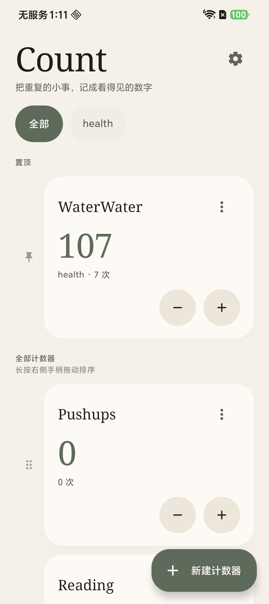
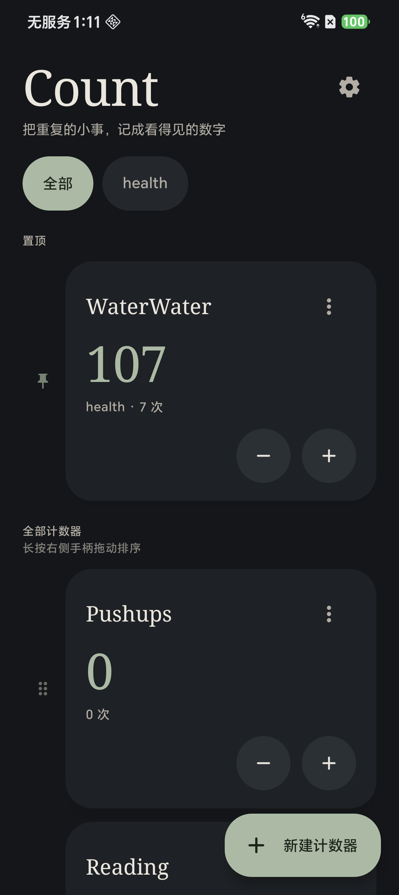
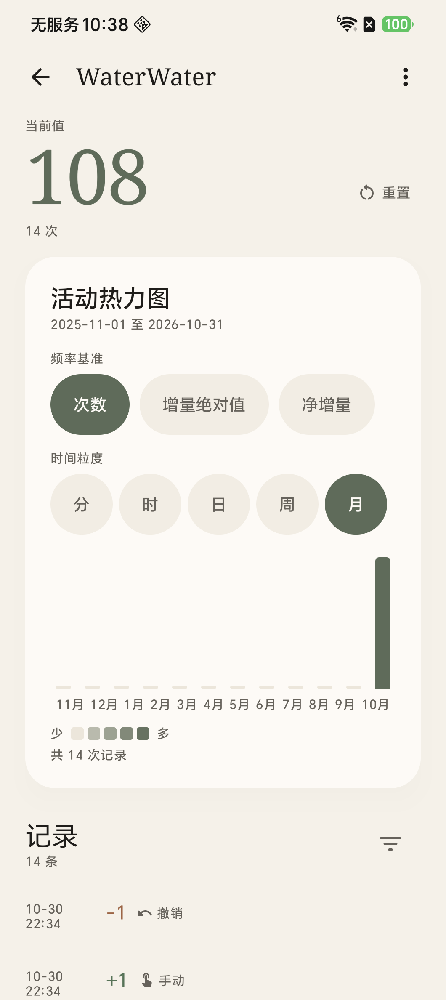
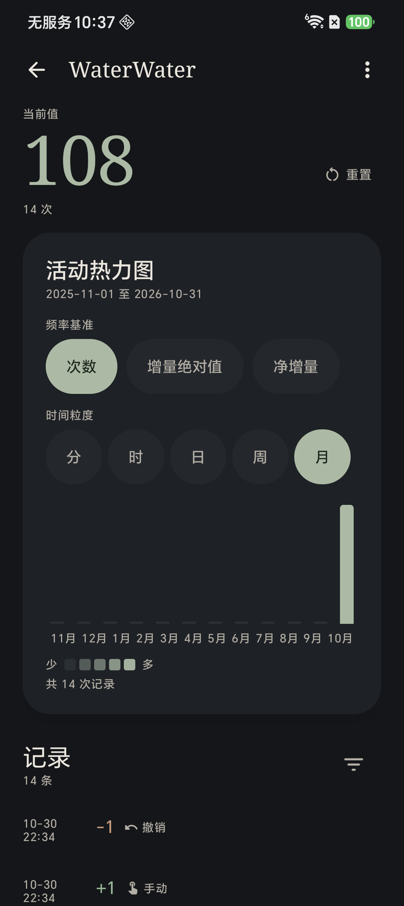
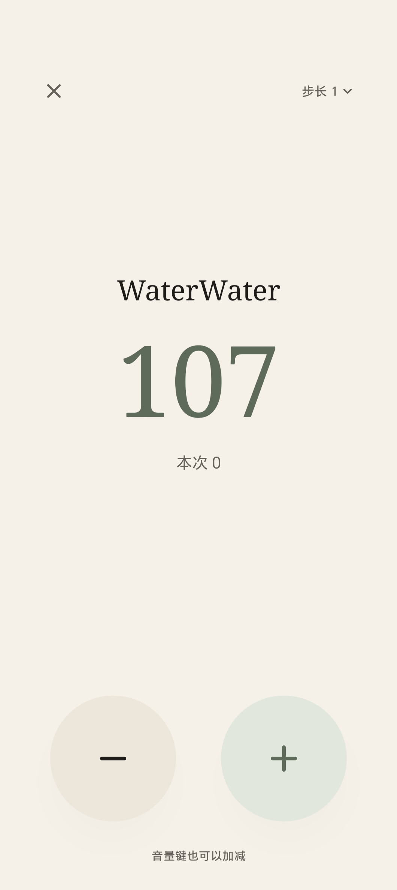
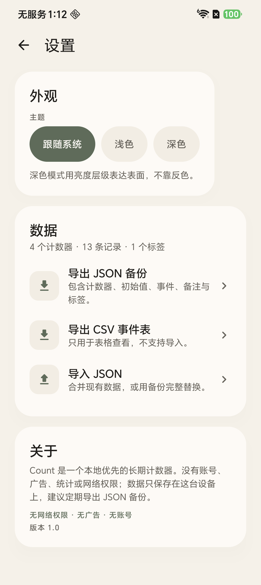
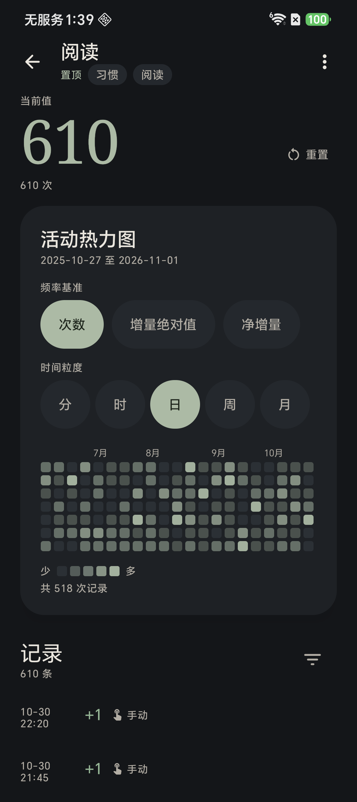

# Count

一个本地优先的长期计数器：没有账号、没有广告、没有统计，也没有网络权限。所有数据只保存在你自己的设备上。

适合记录喝水、阅读、锻炼、债务、习惯打卡这类「每天加一两次、想看长期趋势」的小事。

## 功能

- **事件溯源**：只保存初始值和不可变事件，当前值始终由 `initialValue + Σdelta` 计算，从不落库。
- **主页**：置顶、拖拽排序、标签筛选、任意数量标签、紧凑 / 标准 / 宽松三档卡片大小。
- **详情**：事件列表、备注、时间/正负筛选、单条或范围撤销、重置到初始值。
- **热力图**：次数 / 增量绝对值 / 净增量三种基准，分 / 时 / 日 / 周 / 月五种粒度，按本地时区分桶。
- **快速计数**：全屏计数页、音量键加减、桌面快捷方式深链 `count://quick/{id}`。
- **数据**：JSON 完整导出与合并/替换导入，CSV 只读导出。
- **外观**：暖纸浅色 / 深墨深色、衬线数字、等宽数字特性、尊重系统「减少动态效果」。
- **中文 / English** 两套界面文案。

## 界面

| 浅色 · 主页 | 深色 · 主页 |
| --- | --- |
|  |  |

| 浅色 · 详情与月热力图 | 深色 · 详情与月热力图 |
| --- | --- |
|  |  |

| 全屏快速计数 | 设置 |
| --- | --- |
|  |  |

截图来自 Android 16 真机。

## 隐私

- Manifest 不声明 `INTERNET`，应用无法联网；没有广告、统计、账号或第三方 SDK。
- `android:allowBackup="false"`：数据不会进入系统自动备份，卸载应用即删除。
- 数据保存在应用私有目录；导出时由你通过系统文件选择器（SAF）决定保存位置。
- 仓库中的示例数据全部为合成数据，不含真实用户信息。

## 安装

### 从源码构建

环境要求：JDK 17、Android SDK Platform 35 + Build-Tools 35.0.0、Gradle Wrapper（仓库自带 8.14.1）。

```powershell
# Windows PowerShell
$env:JAVA_HOME = "C:\path\to\jdk-17"
$env:ANDROID_HOME = "C:\path\to\android-sdk"

.\gradlew.bat :app:assembleDebug
.\gradlew.bat :app:testDebugUnitTest
```

```bash
# macOS / Linux
export JAVA_HOME=/path/to/jdk-17
export ANDROID_HOME=/path/to/android-sdk

./gradlew :app:assembleDebug
./gradlew :app:testDebugUnitTest
```

如果未设置 `ANDROID_HOME`，在项目根目录创建 `local.properties`：

```properties
sdk.dir=/path/to/android-sdk
```

`local.properties` 已被 `.gitignore` 忽略，不会提交。

APK 输出：

```
app/build/outputs/apk/debug/app-debug.apk
```

### 安装到设备

```bash
adb install -r app/build/outputs/apk/debug/app-debug.apk
```

本仓库只提供 debug 签名，未配置 release 签名与 R8 混淆。

## 使用

- 主页 `+` / `−` 按当前步长加减；长按可临时切换 `+1 / +5 / +10 / 自定义`。
- 长按卡片打开菜单（编辑、置顶、标签、快捷方式、快速计数、删除）；长按右侧手柄拖拽排序。
- 点卡片进入详情，可筛选事件、编辑备注、撤销、重置，并查看活动热力图。
- 设置里可以切换主题、卡片大小，导出 JSON/CSV，或导入 JSON。
- 卸载前记得导出 JSON 备份，应用没有自动云备份。

更完整的交互说明见 [使用说明](docs/USAGE.md)，导入格式与合并/替换规则见 [导入与导出](docs/IMPORT_EXPORT.md)。

## 示例数据

[`samples/long-term-demo.json`](samples/long-term-demo.json) 是一份合成的长期使用数据：一个置顶的「阅读」计数器、约 14 个月的事件，以及「习惯」「阅读」两个标签。



导入后打开「阅读」详情，可以看到一年以上、有自然深浅变化的热力图。导入步骤：

1. 把 JSON 传到手机（下载目录即可）。
2. 打开 Count → 设置 → 导入 JSON。
3. 选择文件 → **合并**（保留现有数据；重复导入不会重复计数）。

示例数据全部由脚本合成，不含任何真实个人信息。

## 技术

Kotlin + Jetpack Compose + Material 3，Room 持久化，DataStore 保存偏好，Navigation Compose 管理页面，Coroutines + Flow，MVVM + Repository，手动依赖容器。minSdk 26 / targetSdk 35。

核心是事件溯源：`currentValue` 永远由 `initialValue + Σdelta` 计算；所有写操作在 Room 事务内完成「读取聚合 → 校验 → 追加事件」。

实现细节、数据模型、热力图算法见 [架构](docs/ARCHITECTURE.md)；视觉规范与设计决策见 [视觉与设计决策](docs/DESIGN.md)；测试与验收见 [测试与验收](docs/TESTING.md)。

## 文档

| 文档 | 内容 |
| --- | --- |
| [使用说明](docs/USAGE.md) | 主页、详情、热力图、快速计数、标签、外观、数据 |
| [导入与导出](docs/IMPORT_EXPORT.md) | JSON 结构、校验、合并/替换、负值冲突、CSV、示例数据 |
| [架构](docs/ARCHITECTURE.md) | 技术栈、目录结构、数据流、数据模型、不变量、热力图 |
| [视觉与设计决策](docs/DESIGN.md) | 颜色/字体/动效规范、19 条设计与实现决策 |
| [测试与验收](docs/TESTING.md) | 48 个单元测试、真机验收、黑屏回归、已知限制 |

## 许可证

[GNU Affero General Public License v3.0](LICENSE)（AGPL-3.0）。
